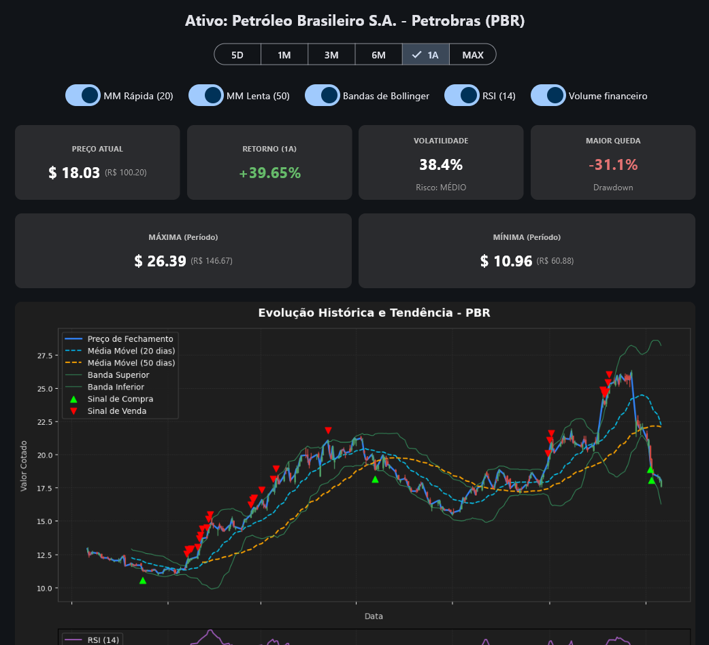

# Dashboard Analítico de Risco em Flet 📈

Aplicação desktop e web para análise visual de risco de ativos financeiras, construída com **Python**, **Flet**, **yfinance** e **Matplotlib**.



## 🚀 Funcionalidades
- Consulta de ativos nacionais (B3) e internacionais em tempo real.
- Análise de volatilidade anualizada, drawdown e retornos acumulados.
- Gráfico interativo com indicadores técnicos: Médias Móveis (20 e 50 períodos), Bandas de Bollinger, RSI (14) e Volume Financeiro.
- Autocomplete com busca integrada ao Yahoo Finance.
- Suporte a Modo Claro e Modo Escuro.

## 🛠️ Como executar
1. Clone este repositório:

```

bash
git clone [https://github.com/SEU-USUARIO/dashboard-risco-flet.git](https://www.google.com/search?q=https%3A%2F%2Fgithub.com%2FSEU-USUARIO%2Fdashboard-risco-flet.git)

```
2. Instale as dependências:

```

bash
pip install -r requirements.txt

```
3. Execute a aplicação:

```

bash
python main.py

```
